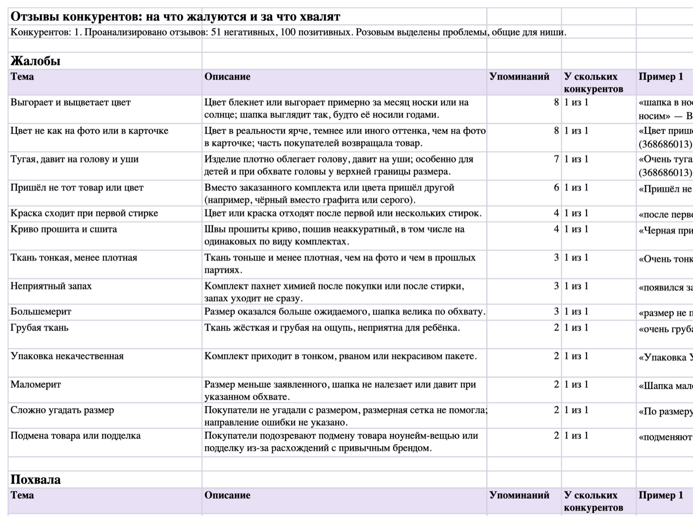
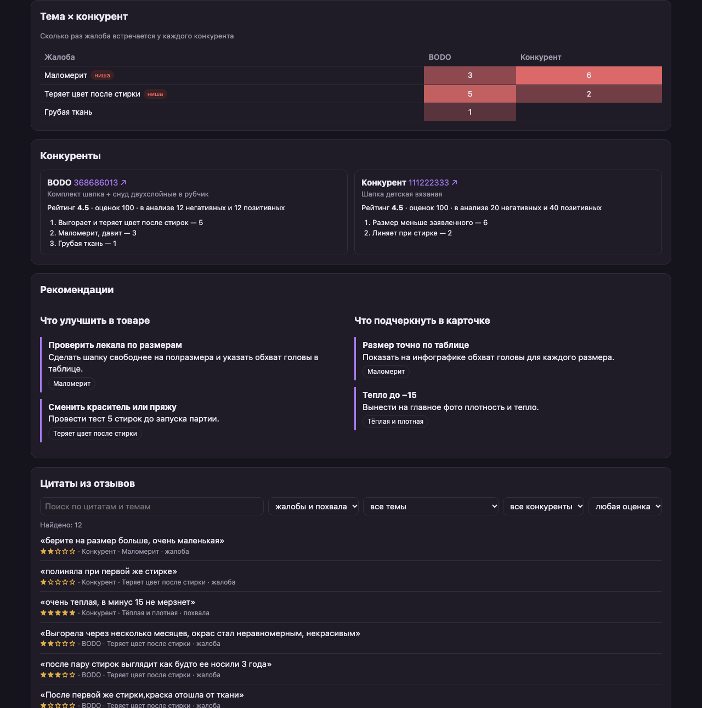
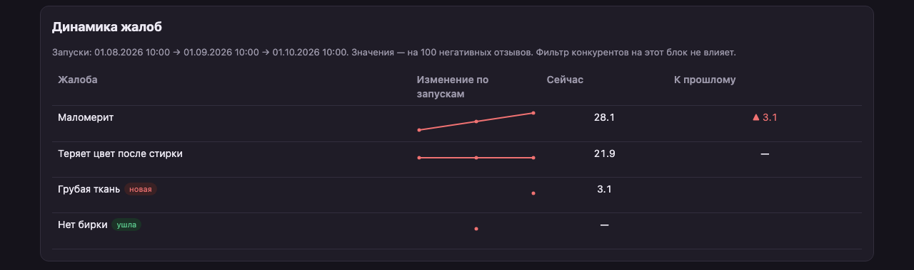

# wb-review-insights

Плагин для Claude Code, который читает отзывы на товары конкурентов на Wildberries
и показывает, **на что покупатели жалуются и за что хвалят**. С отчётом продавец
видит, что улучшить в своём товаре и что подчеркнуть в карточке.

На вход нужен файл со ссылками на товары. На выходе получаются Excel-отчёт,
HTML-дашборд с фильтрами и динамикой между запусками и краткая сводка в чате.



## Что в отчёте

| Лист | Что там |
|---|---|
| **Свод** | Темы жалоб и похвалы: сколько упоминаний, у скольких конкурентов встречается, до 3 примеров отзывов. Розовым выделены проблемы, общие для ниши |
| **Рекомендации** | «Что улучшить в товаре» и «Что подчеркнуть в карточке»: советы со ссылкой на темы, на которых они основаны |
| **Бренд (артикул)** | Лист на каждого конкурента: ссылка, рейтинг, темы с долей от негатива или позитива, цитаты |
| **Сбор** | Какие товары собрались, а какие нет и почему |

Готовый пример лежит в [`examples/run/report.xlsx`](examples/run/report.xlsx). Входные
ссылки к нему — в [`examples/links.txt`](examples/links.txt).

## Как это работает

```
links.txt ─► collect.py ───────────► data/<артикул>.csv
                                          │
             review-analyst (haiku) ◄─────┘  по одному на товар, до 5 параллельно
                    │
                    ▼  results/<артикул>.json  ← проверка schema.py, при ошибке 1 повтор
             insights-writer (sonnet)
                    │
                    ▼  results/summary.json    ← проверка schema.py
               report.py ─► report.xlsx + сводка в чат
            dashboard.py ─► dashboard.html (последний запуск + динамика)
```

- **Python делает только детерминированную работу:** скачивает отзывы, проверяет
  ответы агентов, считает числа и строит Excel. Python не обращается к API нейросетей.
- **Вся работа с текстом достаётся субагентам Claude Code.** `review-analyst` группирует
  отзывы одного товара по темам, а `insights-writer` объединяет темы разных
  конкурентов и пишет выводы.
- **Агенты не могут выдумать цитату:** `schema.py` ищет каждую цитату в исходных
  отзывах и отклоняет результат, если её там нет. Число упоминаний темы по всем
  конкурентам и число конкурентов, у которых она встречается, считает Python, а не нейросеть.

### Какие отзывы берутся

- Отзывы собираются **со всей карточки товара**, то есть со всех цветов и размеров, как их
  видит покупатель на сайте. Цвет и размер сохраняются в CSV.
- **Негатив** — отзывы на 1–3★ плюс отзывы на 4–5★ с заполненными «Недостатками».
  Берутся самые свежие, по умолчанию до 150.
- **Позитив** — остальные отзывы на 4–5★, самые свежие, по умолчанию до 100.
- Только за последние 12 месяцев (настраивается). Пустые отзывы пропускаются.

## Установка

### 1. Установите uv

`uv` запускает Python-скрипты плагина: сам скачивает нужную версию Python (3.11+)
и библиотеки. Он весит около 40 МБ.

```bash
brew install uv
```

Если у вас нет Homebrew, смотрите инструкцию на https://docs.astral.sh/uv/getting-started/installation/

### 2. Установите плагин

**В приложении Claude (вкладка Code).** Команды `/plugin` там нет. Добавьте
в `~/.claude/settings.json` два ключа (если в файле уже есть другие настройки,
допишите эти рядом с ними):

```json
{
  "extraKnownMarketplaces": {
    "wb-review-insights": {
      "source": { "source": "github", "repo": "valer-vm/wb-review-insights" }
    }
  },
  "enabledPlugins": {
    "wb-review-insights@wb-review-insights": true
  }
}
```

Полностью перезапустите приложение (⌘Q) и откройте новую сессию во вкладке Code.

> В «Настройки → Плагины → Мои» после этого виден сам маркетплейс; клик по нему
> открывает его папку в Finder — так и должно быть. Включает плагин именно ключ
> `enabledPlugins`.

**В Claude Code в терминале:**

```
/plugin marketplace add valer-vm/wb-review-insights
/plugin install wb-review-insights@wb-review-insights
```

или из обычной командной строки:

```bash
claude plugin marketplace add valer-vm/wb-review-insights
claude plugin install wb-review-insights@wb-review-insights
```

После установки появятся команды **`/wb-review-insights:analyze-competitors`** и
**`/wb-review-insights:wb-dashboard`**. Команды плагинов всегда идут с префиксом
имени плагина: наберите `/` и начните вводить `analyze` — команда найдётся
в списке. Ниже в тексте для краткости префикс опущен.

> Чтобы проверить плагин до публикации, подключите локальную папку:
> `claude plugin marketplace add /путь/к/wb-review-insights` или
> `claude --plugin-dir /путь/к/wb-review-insights`.

## Запуск

1. Создайте файл `links.txt` со ссылками на товары конкурентов, по одной на строку:

   ```
   https://www.wildberries.ru/catalog/368686013/detail.aspx
   https://www.wildberries.ru/catalog/123456789/detail.aspx
   # строки с решёткой — комментарии
   987654321
   ```

   Подходят обычные ссылки на товар, ссылки с параметрами и просто артикулы.

2. В Claude Code, в папке с этим файлом, выполните:

   ```
   /analyze-competitors links.txt
   ```

   С параметрами:

   ```
   /analyze-competitors links.txt --months 6 --neg-limit 80 --pos-limit 50
   ```

| Параметр | По умолчанию | Что делает |
|---|---|---|
| `--neg-limit` | 150 | Сколько негативных отзывов брать с товара, не больше |
| `--pos-limit` | 100 | Сколько позитивных отзывов брать с товара, не больше |
| `--months` | 12 | Только отзывы за последние N месяцев, `0` — за всё время |

3. Запуски складываются по спискам: имя папки — имя файла со ссылками.
   Так у каждого списка своя история:

   ```
   wb-insights/
     dashboard.toml              настройки дашборда (общие для всех списков)
     шапки/                      из файла шапки.txt
       dashboard.html            дашборд: последний запуск + динамика
       2026-10-15_120000/
         data/                   CSV с отзывами, meta.json, _status.json (что собралось)
         results/                JSON от субагентов
         report.xlsx             отчёт
       2026-11-15_120000/
         ...
   ```

Если какой-то товар не собрался (неверная ссылка, товар удалён, сайт недоступен),
команда продолжит работу с остальными и в конце сообщит, что не вошло в отчёт.

### Запуск скриптов без Claude

Скрипты можно запускать и по отдельности, например чтобы заранее посмотреть,
сколько отзывов соберётся:

```bash
uv run scripts/collect.py links.txt --out run/data
uv run scripts/schema.py result run/results/368686013.json --csv run/data/368686013.csv
uv run scripts/report.py --run run
```

## Дашборд

После каждого `/analyze-competitors` рядом с запусками появляется
`wb-insights/<список>/dashboard.html`. Это один файл: он открывается двойным кликом
в любом браузере, работает без интернета и пересылается как обычный файл.



Пример: [`examples/dashboard_demo.html`](examples/dashboard_demo.html). Он собран
на тестовых данных из трёх условных запусков, чтобы показать динамику. Бренд
«Конкурент» и его отзывы выдуманы.

### Блоки

| Блок | Что показывает |
|---|---|
| Итоги | Число конкурентов и отзывов, средний рейтинг, главная жалоба, краткая сводка |
| Топ жалоб / Топ похвалы | Темы по числу упоминаний и охвату конкурентов; общие для ниши помечены |
| Тема × конкурент | Тепловая карта: у кого из конкурентов какая проблема и насколько часто |
| Конкуренты | Рейтинг, число оценок, три главные жалобы каждого |
| Рекомендации | «Что улучшить» и «что подчеркнуть»; клик по теме открывает её цитаты |
| Цитаты | Все примеры отзывов с поиском и фильтрами по теме, конкуренту и оценке |
| Динамика | Как менялись жалобы между запусками, отметки «новая» и «ушла» |

Вверху страницы есть фильтры: какие конкуренты учитываются (числа пересчитываются),
«только общие для ниши» и минимальное число упоминаний.

### Динамика между запусками



- Сравниваются запуски **с тем же набором товаров** в файле со ссылками. Если вы
  добавили или убрали конкурента, история начинается заново, а дашборд пишет, сколько
  старых запусков не вошло в сравнение.
- По умолчанию значения считаются **на 100 негативных отзывов**: так они не зависят от
  `--neg-limit` и от того, сколько отзывов собралось.
- Агенты каждый раз называют темы заново. Чтобы одна проблема называлась одинаково,
  `insights-writer` получает названия тем из прошлого запуска и переиспользует их.
  Если тема всё же разъехалась (в одном запуске «Маломерит», в другом «Размер меньше
  заявленного»), добавьте синоним в `[aliases]` в настройках.

### Настройки: `wb-insights/dashboard.toml`

Файл создаётся при первом запуске; в нём есть комментарии. Пример со значениями
по умолчанию — [`examples/dashboard.toml`](examples/dashboard.toml).

```toml
[blocks]
order  = ["summary", "complaints", "praise", "matrix", "competitors",
          "recommendations", "quotes", "history"]
hidden = ["praise"]            # скрыть блоки

[top]
complaints = 10                # сколько тем в графиках и матрице
praise = 10

[filters]                      # значения фильтров при открытии
min_mentions = 2
niche_only = false

[history]
max_runs = 12                  # сколько последних запусков в динамике
metric = "per100"              # или "absolute" — просто число упоминаний

[aliases]                      # ручные синонимы тем
"Маломерит" = ["Размер меньше заявленного", "Тугая, давит"]
```

После правки пересоберите дашборд:

```
/wb-dashboard шапки
```

Команда не запускает субагентов и не тратит лимиты. Без аргумента она покажет
доступные списки. Если в настройках ошибка, скрипт скажет, какое поле поправить.

То же самое без Claude:

```bash
uv run scripts/dashboard.py wb-insights/шапки
```

## Как ограничить расход лимитов

Больше всего лимитов расходуют субагенты. Ориентиры по нашему прогону: на один товар
со 150 отзывами `review-analyst` (haiku) тратит около 100 тыс. токенов, а
`insights-writer` (sonnet) — около 70 тыс. токенов на всю сводку.

Что помогает:

- **Меньше отзывов.** `--neg-limit 60 --pos-limit 30` примерно втрое сокращает работу
  `review-analyst`. Негатив важнее для анализа, поэтому позитив урезайте сильнее.
- **Свежие отзывы.** `--months 6` отсекает старые отзывы, а часто это ещё и полезнее для анализа.
- **Меньше конкурентов за раз.** Для первого знакомства с нишей хватает 3–5 товаров.
- **Модели.** Модель задаётся в первых строках файлов `agents/review-analyst.md`
  и `agents/insights-writer.md` (поле `model:`). `review-analyst` уже работает на
  самой дешёвой модели (haiku). `insights-writer` можно перевести на haiku ценой
  качества выводов.
- **Повторы.** Если ответ агента не прошёл проверку, команда запускает его ещё раз.
  Частые повторы — повод сообщить о проблеме, а не увеличивать лимиты.
- **Дашборд бесплатен.** `/wb-dashboard` и правка настроек лимиты не тратят.
- **Сначала сбор.** Запустите `uv run scripts/collect.py links.txt` и посмотрите, сколько
  отзывов собралось, прежде чем запускать анализ.

## Если WB поменял запрос

Отзывы собираются через те же внутренние JSON-запросы, которые использует сам сайт.
Если WB их поменяет, `collect.py` начнёт писать ошибки вроде «отказал в доступе (403)»,
«вернул не JSON» или «не удалось получить отзывы». Вот как найти новый запрос.

### Найти запрос в браузере

**Safari:**
1. Включите инструменты разработчика: **Safari → Настройки → Дополнения →
   «Показывать функции для веб-разработчиков»**.
2. Откройте любой товар на wildberries.ru и нажмите **⌥⌘I**, затем откройте вкладку **Сеть**.
3. Выберите фильтр **XHR/выборка** и обновите страницу (⌘R).
4. Откройте блок отзывов на странице.
5. В поле фильтра введите `feedback`.

**Chrome:** нажмите **F12** (или ⌥⌘I) и откройте вкладку **Network**, выберите фильтр
**Fetch/XHR** и дальше действуйте так же.

Нужный запрос — тот, в ответе которого (вкладка **Ответ** / **Response**) видны тексты
отзывов. На октябрь 2026 года он выглядит так:

```
https://feedback-view-02.wb.ru/feedbacks/v2/11819787
```

Число в конце — **`imtId`**, то есть id карточки товара. Это не артикул из ссылки.
Правый клик по запросу → **Copy as cURL** («Скопировать как cURL»), чтобы увидеть
заголовки.

`imtId` по артикулу скрипт берёт из статического файла карточки:

```
https://basket-21.wbbasket.ru/vol3686/part368686/368686013/info/ru/card.json
```

Здесь `vol` = артикул // 100000, `part` = артикул // 1000.

### Что поправить в коде

Всё, что зависит от WB, собрано в начале [`scripts/collect.py`](scripts/collect.py):

| Что поменялось | Что править |
|---|---|
| Домен запроса отзывов | `FEEDBACK_HOSTS` |
| Путь запроса отзывов | `FEEDBACK_PATH` |
| Адрес файла карточки | `CARD_URL`, таблица `BASKET_RANGES` |
| Нужны другие заголовки | `HEADERS` (сравните с cURL из браузера) |
| Поменялись имена полей в ответе | функция `select_reviews`: `productValuation`, `text`, `pros`, `cons`, `createdDate`, `color`, `size`, `nmId` |

После правки сохраните свежий ответ как образец для тестов, поправьте фикстуры
в `tests/fixtures/` и прогоните тесты (см. ниже).

## Разработка

```bash
uv run pytest
```

Тесты не обращаются к сайту: они работают на сохранённых и обезличенных ответах WB
из `tests/fixtures/`.

> **Если в пути к папке есть двоеточие** (в Finder оно выглядит как `/`, например
> `programms/scripts`), `uv run pytest` падает с ошибкой
> `path segment contains separator ':'`. В таком случае вынесите окружение из папки:
> `UV_PROJECT_ENVIRONMENT=~/.cache/wb-review-insights-dev uv run pytest`.
> Скрипты (`uv run scripts/...`) это не затрагивает.

### Структура проекта

```
.claude-plugin/
  plugin.json             описание плагина
  marketplace.json        маркетплейс из одного плагина (для /plugin marketplace add)
commands/
  analyze-competitors.md  команда /analyze-competitors
  wb-dashboard.md         команда /wb-dashboard — пересобрать дашборд
agents/
  review-analyst.md       субагент: анализ отзывов одного товара (haiku)
  insights-writer.md      субагент: сводка по нише и рекомендации (sonnet)
scripts/
  collect.py              сбор отзывов с WB в CSV
  schema.py               проверка JSON от субагентов, подсчёт сводных чисел
  report.py               Excel-отчёт
  dashboard.py            HTML-дашборд, история запусков, словарь тем
  dashboard_template.html шаблон страницы дашборда (без внешних библиотек)
tests/                    pytest + фикстуры (сохранённые ответы WB)
examples/                 пример входа, результатов, отчёта и дашборда
pyproject.toml            зависимости для uv
requirements.txt          те же зависимости для pip
```

## Ограничения первой версии

- **Только Wildberries.** Нет веб-интерфейса и базы данных, капчу программа не обходит.
  Если WB начнёт требовать капчу, сбор остановится с понятной ошибкой.
- **Упоминания считаются приблизительно.** `review-analyst` считает их сам и может ошибиться
  на 1–2 в крупных темах. Цитаты при этом всегда дословные.
- **Пример отчёта в `examples/run/` сделан по одному конкуренту.** Поэтому в нём нет тем,
  общих для ниши. На реальном списке из нескольких товаров они появятся. Пример
  дашборда собран на тестовых данных.
- **Динамика зависит от того, как названы темы.** Словарь тем и синонимы сильно
  помогают, но если агент назвал тему иначе, она покажется как «новая», а старая —
  как «ушла». Это лечится строкой в `[aliases]`.
- **Карточку со многими цветами программа считает одним товаром.** Если две ссылки ведут
  на разные цвета одной карточки, вторая будет пропущена как дубль.
